# GeoVault — Bhu-Explorer

> **Land Intelligence. Boundary Clarity.**  
> A high-precision geospatial land exploration and boundary-analysis system for interactive cadastral parcel visualization, spatial geometry calculations, boundary conflict detection, and land-record workflows.

---

## Table of Contents

- [Overview](#overview)
- [Prototype Status & Disclaimers](#prototype-status--disclaimers)
- [Architecture Status: Current vs. Agreed Stack](#architecture-status-current-vs-agreed-stack)
- [System Architecture Diagram](#system-architecture-diagram)
- [End-to-End Data Flow](#end-to-end-data-flow)
- [Technology Stack Breakdown](#technology-stack-breakdown)
  - [Frontend](#frontend)
  - [Backend](#backend)
  - [Database & Spatial Processing (Agreed Architecture)](#database--spatial-processing-agreed-architecture)
  - [Document Processing (Under Evaluation)](#document-processing-under-evaluation)
  - [Testing & Quality Assurance](#testing--quality-assurance)
- [Key Features](#key-features)
  - [1. Currently Implemented Features](#1-currently-implemented-features)
  - [2. Simulated Prototype Behaviors](#2-simulated-prototype-behaviors)
  - [3. Planned Features & Milestones](#3-planned-features--milestones)
- [Geometry Engine & Spatial Calculations](#geometry-engine--spatial-calculations)
  - [Current Formulas & Implementation](#current-formulas--implementation)
  - [Current Algorithmic Constraints](#current-algorithmic-constraints)
  - [Planned Shapely Enhancements](#planned-shapely-enhancements)
- [Project Directory Structure](#project-directory-structure)
- [Application Navigation & Workspaces](#application-navigation--workspaces)
  - [Client-Side Routes](#client-side-routes)
  - [Dashboard Workspaces](#dashboard-workspaces)
- [Keyboard Shortcuts & Interactions](#keyboard-shortcuts--interactions)
- [Backend Endpoints & API Specifications](#backend-endpoints--api-specifications)
  - [Implemented Endpoints (Week 1 Milestone)](#implemented-endpoints-week-1-milestone)
  - [Planned Endpoints (Future Milestones)](#planned-endpoints-future-milestones)
- [Sample Data Reference](#sample-data-reference)
- [Prerequisites](#prerequisites)
- [Installation & Local Development](#installation--local-development)
  - [Starting the Frontend Application](#starting-the-frontend-application)
  - [Starting the FastAPI Backend Service](#starting-the-fastapi-backend-service)
  - [Stopping the Development Servers](#stopping-the-development-servers)
- [Production Build & Code Formatting](#production-build--code-formatting)
- [Testing & Verification Status](#testing--verification-status)
- [Security, Privacy & Data Governance](#security-privacy--data-governance)
- [Development Roadmap](#development-roadmap)
- [License & Contributions](#license--contributions)

---

## Overview

**GeoVault — Bhu-Explorer** addresses the challenge of navigating fragmented land records and static cadastral maps by providing an integrated, coordinate-aware land intelligence platform.

In modern property management and municipal cadastre administration, records often exist as disconnected physical deeds, static scanned PDFs, or isolated map sheets. GeoVault demonstrates a unified environment where cadastral land parcels can be:
- Explored interactively on a coordinate-aware vector map canvas.
- Computed for exact geometric dimensions (surface area, perimeter, centroid coordinates).
- Analyzed in real time for boundary overlaps, disputes, and spatial discrepancies.
- Compared across historic baseline surveys and simulated revision datasets.
- Processed alongside deed document extraction workflows.

The project consists of:
1. **Frontend**: A React 19 + TypeScript + Vite single-page application with a custom black-and-red aesthetic, originally designed in **Figma Make** and engineered in **Antigravity**.
2. **Backend**: An initial **FastAPI** service (`backend/app`) running on Python 3.11+, providing CORS-enabled REST endpoints, service discovery, and health checks as part of the **Week 1 milestone**.

---

## Prototype Status & Disclaimers

> [!IMPORTANT]
> **GeoVault is currently an engineering prototype and research platform.**
> - **NOT an Official Government Portal:** GeoVault is not operated by, affiliated with, or endorsed by any governmental land registry, revenue department, or survey bureau.
> - **NOT a Real Estate Marketplace:** The system does not list properties for sale, broker property deals, or conduct financial land transactions.
> - **Fictional Sample Data:** All cadastral parcels (`GV-041` through `GV-064`), boundary coordinates, survey references, and owners depicted in the application are synthetic fixtures situated conceptually in a fictional "Sector 08" grid.
> - **No Legal Determination:** Spatial calculations, boundary clipping results, and overlap alerts generated by GeoVault do not establish legal property ownership, verify official title deeds, determine encroachment, or serve as admissible evidence in boundary disputes.

---

## Architecture Status: Current vs. Agreed Stack

To maintain strict technical clarity, the project distinguishes among three operational tiers:

```
+-----------------------------------------------------------------------------------------------+
| 1. Currently Implemented             | 2. Agreed Architecture (Planned) | 3. Under Evaluation |
+--------------------------------------+----------------------------------+---------------------+
| - React 19 + TypeScript 5 frontend   | - PostgreSQL + PostGIS database  | - Tesseract OCR     |
| - Vite 8 dev server & bundler        | - Leaflet & React-Leaflet        | - PaddleOCR         |
| - Custom SVG Map Canvas              | - Shapely Geometry Engine        |                     |
| - Tailwind CSS v4 + Design Tokens    | - GeoAlchemy2 & SQLAlchemy ORM   |                     |
| - Client-side Sutherland-Hodgman     | - Alembic Schema Migrations      |                     |
| - FastAPI Backend Service (Week 1)   | - Vitest, pytest, Playwright     |                     |
| - Pydantic v2 Response Schemas       | - Docker Compose local setup     |                     |
| - CORS Middleware for local Vite     |                                  |                     |
| - oxfmt code formatter               |                                  |                     |
+-----------------------------------------------------------------------------------------------+
```

1. **Currently Implemented:** The running codebase present in the repository today—the standalone React 19 frontend and the Week 1 FastAPI backend service with health-check and metadata endpoints.
2. **Agreed but Not Yet Integrated:** The agreed full-stack system components designed to provide persistent spatial database storage, enterprise GIS mapping, and backend geometry processing.
3. **Under Evaluation / Future Consideration:** Specialized libraries being benchmarked (such as real OCR engines) prior to installation and integration.

---

## System Architecture Diagram

The agreed architecture connects the interactive React user interface to the Python FastAPI backend, spatial computation engines, and a PostGIS relational database:

```mermaid
graph TD
    subgraph Frontend ["Frontend (Client Layer — React 19)"]
        UI["React 19 UI & Custom Design System"]
        SVGMap["Current SVG Vector Canvas\n(Implemented)"]
        LeafletMap["Leaflet / React-Leaflet\n(Agreed Architecture Milestone)"]
        ClientGeo["geometry.ts\n(Client-side Shoelace & Sutherland-Hodgman)"]
        UI --> SVGMap
        UI -.->|Future Migration| LeafletMap
        SVGMap --> ClientGeo
    end

    subgraph BackendGateway ["API Gateway & REST Layer (FastAPI — Week 1 Implemented)"]
        FastAPI["FastAPI Application (backend/app/main.py)"]
        Pydantic["Pydantic Schemas\n(Root & Health Validation)"]
        AuthMiddleware["CORS Middleware\n(Allowing 8443 / 5173 Origins)"]
        HealthRoute["GET /health & GET /\n(Implemented)"]
        FastAPI --> Pydantic
        FastAPI --> AuthMiddleware
        FastAPI --> HealthRoute
    end

    subgraph SpatialProcessing ["Spatial Computation & Document Intelligence (Planned)"]
        Shapely["Shapely (GEOS C-Engine)\n(Robust Intersection, Buffer, Union)"]
        OCREngine["OCR Evaluation Engine\n(Tesseract OCR or PaddleOCR)"]
    end

    subgraph Persistence ["Data & Migration Layer (Agreed Backend — Planned)"]
        SQLAlchemy["SQLAlchemy ORM + GeoAlchemy2"]
        Alembic["Alembic Schema Migrations"]
        PostGIS[("PostgreSQL 15+ with PostGIS\n(Spatial Tables & GiST Indexes)")]
        SQLAlchemy --> PostGIS
        Alembic --> PostGIS
    end

    %% Connections
    UI -.->|HTTP / REST (Port 8000)| FastAPI
    FastAPI -.->|Planned Integration| SpatialProcessing
    FastAPI -.->|Planned Integration| SQLAlchemy
    SpatialProcessing -.-> Shapely
    SpatialProcessing -.-> OCREngine
```

---

## End-to-End Data Flow

The intended data flow traces how spatial queries, boundary analyses, and document extractions propagate through the complete stack:

```mermaid
sequenceDiagram
    autonumber
    actor User as User / Land Surveyor
    participant UI as React 19 Frontend (:8443)
    participant API as FastAPI REST Gateway (:8000)
    participant GeoEngine as Shapely Spatial Engine
    participant DB as PostGIS Spatial Database
    participant OCR as OCR Worker (Tesseract / PaddleOCR)

    %% Scenario A: Service Verification (Week 1 Implemented)
    rect rgb(20, 25, 20)
    note right of User: Scenario A: Initial Backend Discovery & Health Verification (Implemented)
    User->>API: GET /health or GET /
    API-->>User: 200 OK {"status": "healthy", "service": "geovault-backend", "version": "0.1.0"}
    User->>API: GET /docs
    API-->>User: 200 OK (Interactive Swagger UI documentation)
    end

    %% Scenario B: Boundary Conflict Analysis (Planned Full-Stack)
    rect rgb(25, 25, 25)
    note right of User: Scenario B: Boundary Overlap Analysis (Planned Full-Stack)
    User->>UI: Selects Parcel A & Parcel B for boundary analysis
    alt Current Standalone Prototype
        UI->>UI: Runs local Sutherland-Hodgman clipping in geometry.ts
        UI-->>User: Displays calculated overlap & conflict alert
    else Full-Stack Agreed Architecture (Planned)
        UI->>API: POST /api/v1/analysis/intersect (parcel_a_id, parcel_b_id)
        API->>DB: Query ST_Intersection(a.geom, b.geom) via GeoAlchemy2
        DB-->>API: Returns intersected WKB / GeoJSON geometry
        API->>GeoEngine: Validates non-convex topology & computes metrics
        GeoEngine-->>API: Returns exact area (m²), perimeter, overlap %
        API-->>UI: 200 OK with GeoJSON conflict polygon & overlap metrics
        UI->>UI: Renders conflict polygon on map canvas & updates HUD
        UI-->>User: Displays verified conflict report & download link
    end
    end

    %% Scenario C: Land Deed Document Extraction (Planned Full-Stack)
    rect rgb(20, 20, 20)
    note right of User: Scenario C: Land Deed Document Processing (Planned Full-Stack)
    User->>UI: Uploads property deed PDF/image in Deed OCR
    alt Current Standalone Prototype
        UI->>UI: Generates object URL preview & triggers 1.2s mock extraction
        UI-->>User: Renders editable sample fields (GV-054, SD-08-5421)
    else Full-Stack Agreed Architecture (Planned)
        UI->>API: POST /api/v1/documents/extract (multipart/form-data)
        API->>OCR: Runs OCR image pre-processing & text extraction
        OCR-->>API: Extracted bounding boxes, survey refs, plot areas
        API->>DB: Cross-references extracted survey ID with cadastral tables
        DB-->>API: Returns matching parcel record
        API-->>UI: 200 OK with extracted fields & matched parcel ID
        UI-->>User: Displays extracted deed data for manual confirmation
    end
    end
```



---

## Technology Stack Breakdown

### Frontend

| Technology | Status | Role & Implementation Details |
| :--- | :--- | :--- |
| **React 19** (`react ^19.0.0`) | **Currently Implemented** | Modern component lifecycle, hooks (`useState`, `useEffect`, `useRef`), and StrictMode mounting in [`src/main.tsx`](file:///d:/GeoVault/src/main.tsx). |
| **TypeScript 5.7+** | **Currently Implemented** | Static typing with strict mode, DOM types, bundler module resolution, and path alias `@/*` configured in [`tsconfig.json`](file:///d:/GeoVault/tsconfig.json). |
| **Vite 8** (`vite ^8.0.5`) | **Currently Implemented** | Fast HMR dev server and production bundler configured in [`vite.config.ts`](file:///d:/GeoVault/vite.config.ts) with `@vitejs/plugin-react`. |
| **Tailwind CSS v4** (`^4.0.0`) | **Currently Implemented** | Native `@tailwindcss/vite` plugin import with global design tokens and custom CSS in [`src/index.css`](file:///d:/GeoVault/src/index.css). |
| **Custom SVG Map Canvas** | **Currently Implemented** | High-performance inline SVG vector renderer handling contour topography, roads, cadastral polygons, and interactive vertex handles. |
| **Leaflet & React-Leaflet** | **Agreed Architecture (Not Yet Integrated)** | Agreed requirement for standard GIS map tiles, satellite basemaps, and projection support. The existing SVG map canvas must be evaluated and bridged during this milestone. |

### Backend

| Technology | Status | Role & Implementation Details |
| :--- | :--- | :--- |
| **Python 3.11+** | **Currently Implemented** | Backend runtime environment (verified on Python 3.14). |
| **FastAPI** (`fastapi>=0.110.0`) | **Currently Implemented (Week 1 Milestone)** | Asynchronous REST application in [`backend/app/main.py`](file:///d:/GeoVault/backend/app/main.py) with Swagger docs at `/docs` and health check at `/health`. |
| **Pydantic v2** (`pydantic>=2.6.0`) | **Currently Implemented (Week 1 Milestone)** | Typed response validation schemas (`RootResponse`, `HealthCheckResponse`). |
| **Uvicorn** (`uvicorn[standard]>=0.28.0`) | **Currently Implemented (Week 1 Milestone)** | Production-grade ASGI server serving the FastAPI backend on `127.0.0.1:8000`. |
| **python-dotenv** (`python-dotenv>=1.0.0`) | **Currently Implemented (Week 1 Milestone)** | Environment configuration management supporting `.env` files. |
| **SQLAlchemy 2.0** | **Agreed Architecture (Not Yet Integrated)** | Asynchronous Object Relational Mapper for database access in future milestones. |
| **Alembic** | **Agreed Architecture (Not Yet Integrated)** | Database migration tool to manage and version database schema evolution reproducibly. |

### Database & Spatial Processing (Agreed Architecture)

| Technology | Status | Role & Target Functionality |
| :--- | :--- | :--- |
| **PostgreSQL 15+ with PostGIS** | **Agreed Architecture (Not Yet Integrated)** | Relational database with enterprise spatial extensions for indexing (`GiST`), storing, and querying cadastral geometries (`GEOMETRY(Polygon, 4326)`). |
| **GeoAlchemy2** | **Agreed Architecture (Not Yet Integrated)** | Bridges SQLAlchemy with PostGIS spatial types, enabling spatial operators like `ST_Intersects`, `ST_Area`, and `ST_Centroid` directly in queries. |
| **Shapely 2.0+** | **Agreed Architecture (Not Yet Integrated)** | Python wrapper around the GEOS C library. Will handle complex geometric validations, non-convex polygon clipping, spatial buffering, and simplification on the backend. |

### Document Processing (Under Evaluation)

| Engine | Status | Evaluation Criteria & Scope |
| :--- | :--- | :--- |
| **Tesseract OCR** (`pytesseract`) | **Future Consideration / Under Evaluation** | Open-source, CPU-efficient OCR engine. Well-suited for standard printed deeds and alphanumeric survey reference numbers. |
| **PaddleOCR** | **Future Consideration / Under Evaluation** | Deep-learning-based OCR pipeline with robust multi-language and complex tabular recognition. Suitable for multi-column land deed schedules and noisy scanned documents. |

> [!NOTE]
> Neither OCR engine is currently installed or bundled with the project. Document processing in the current application is purely client-side simulation.

### Testing & Quality Assurance

| Tool | Status | Scope |
| :--- | :--- | :--- |
| **oxfmt** (`^0.2.0`) | **Currently Implemented** | Fast Rust-based code formatter configured for source formatting (`pnpm oxfmt src`). |
| **Vite Production Build** | **Currently Implemented** | TypeScript compilation and asset bundling verification (`pnpm build`). |
| **FastAPI Test & Health Suite** | **Currently Implemented** | HTTP endpoint verification on running Uvicorn server (`GET /`, `GET /health`, `GET /docs`). |
| **Vitest** | **Agreed Architecture (Not Yet Integrated)** | Planned unit testing framework for frontend components, custom hooks, and `geometry.ts` algorithms. |
| **pytest** | **Agreed Architecture (Not Yet Integrated)** | Planned test suite for backend FastAPI endpoints, Pydantic validation, and Shapely spatial algorithms. |
| **Playwright** | **Agreed Architecture (Not Yet Integrated)** | Planned browser-level end-to-end testing for map panning, polygon drawing, vertex editing, and report downloads. |
| **Docker Compose** | **Agreed Architecture (Not Yet Integrated)** | Planned container orchestration for local PostgreSQL/PostGIS and FastAPI services. |

---

## Key Features

### 1. Currently Implemented Features

- **FastAPI Backend Gateway (Week 1 Milestone)**:
  - High-performance asynchronous FastAPI server running at `http://127.0.0.1:8000`.
  - Operational health endpoint `GET /health` returning service status, identifier, and version.
  - Root discovery endpoint `GET /` returning service metadata and documentation links.
  - Interactive Swagger UI documentation automatically rendered at `GET /docs` and ReDoc at `GET /redoc`.
  - Cross-Origin Resource Sharing (CORS) configured for local development origins (`http://localhost:8443`, `http://localhost:5173`, etc.) with customizable `.env` support.
- **Cadastral Vector Map Canvas**:
  - 900×520 coordinate viewport rendering fictional parcel boundaries, roads, contours, and labels.
  - Interactive panning with native pointer capture and mouse-drag tracking.
  - Zoom controls (`+` / `-`), center-selected parcel shortcut, and map reset action.
  - Dynamic scale bar adapting in real time to the current zoom level.
  - Live cursor tracking HUD displaying approximate geographic coordinates (WGS 84 latitude/longitude).
  - Multi-layer visibility toggles for Parcel Boundaries, IDs, Conflict Zones, Survey Grid, and Document Overlays.
- **Perspective 3D Visualization**:
  - Dynamic 3D perspective mode (`view-3d`) applying CSS 3D matrix transforms (`--rotate-x`, `--rotate-z`).
  - Interactive pitch ($35^\circ$ to $72^\circ$) and yaw ($-18^\circ$ to $18^\circ$) manipulation via mouse drag.
- **Parcel Search & Synchronization**:
  - Live search input with instant substring matching and suggestion dropdowns.
  - Bi-directional hover highlighting between search results, recent parcels list, and map shapes.
  - Synchronized selection updating the Intelligence HUD, parcel properties, and nearby relationships.
- **Geometry Drawing & Measurement Tools**:
  - Distance measurement tool computing Euclidean line lengths in meters between clicked points.
  - Polygon drawing tool with real-time vertex addition and interactive vertex drag handles.
  - Keyboard vertex nudging (<kbd>Arrow</kbd> keys) for pixel-accurate geometry refinement.
  - Self-intersection detection and minimum area validation before closing custom polygons.
- **Boundary Conflict Analysis Engine**:
  - Comparative clipping of any two selected parcels using the Sutherland–Hodgman algorithm.
  - Multi-stage scanning animation with real-time percentage progress bar.
  - Intersected conflict polygon rendered with alert badges and centroid warning markers.
  - Exact calculation of intersection area ($m^2$), intersection perimeter ($m$), and percentage overlap.
- **Before-and-After Boundary Comparison Workspace**:
  - Compares baseline parcels against a simulated revised survey dataset (`comparisonParcels`).
  - Interactive split slider ($5\%$ to $95\%$) revealing baseline vs. revised boundaries.
  - Area difference calculation highlighting changed edges in crimson red.
- **Nearest-Neighbor Relationship Explorer**:
  - Automatic calculation of nearest neighbor parcels based on centroid Euclidean distances.
  - Interactive radial node graph linking adjacent plots with single-click selection.
- **Keyboard Command Palette (`Ctrl + K` / `Cmd + K`)**:
  - Fast keyboard modal with arrow-key navigation and instant action execution.
- **Session History & Data Export**:
  - Session timeline tracking parcel inspections and completed intersection analyses.
  - Formatted text report download (`geovault-*-analysis.txt`) via client-side Blob generation.
- **Accessibility & Motion Preferences**:
  - Full `@media (prefers-reduced-motion: reduce)` support disabling animations, transitions, and card tilts.
  - Visible focus rings (`outline: 2px solid var(--bright-red)`) and ARIA live regions for status changes.

---

### 2. Simulated Prototype Behaviors

| Feature | Current Simulated Logic | Future Real Implementation |
| :--- | :--- | :--- |
| **Land Deed OCR Workspace** | File input accepts `.pdf`, `.png`, `.jpg`. Displays image preview and simulates extraction after a 1.2s delay, pre-filling sample fields (`GV-054`, `SD-08-5421`, area, 96.4% confidence). | Uploads document to FastAPI backend, runs evaluated OCR engine, extracts real text, and matches cadastral survey numbers. |
| **Boundary Comparison Data** | Revisions for parcels `GV-054`, `GV-055`, and `GV-063` are hardcoded in `comparisonParcels`. | Historical survey versions retrieved from PostGIS temporal tables (`survey_revisions`). |
| **Analysis Progress Sweep** | Animated timer stages (8% $\rightarrow$ 34% $\rightarrow$ 67% $\rightarrow$ 91% $\rightarrow$ 100%) simulate computational latency. | Real-time WebSocket or task progress from server-side spatial execution. |

---

### 3. Planned Features & Milestones

- **Leaflet / React-Leaflet Map Migration**:
  - Integrate Leaflet to display authoritative GIS basemaps (OpenStreetMap, satellite imagery, Bhuvan tiles).
  - Transition from local SVG canvas units to standard geographic CRS (`EPSG:4326` and `EPSG:3857`).
- **PostGIS Spatial Database Backend**:
  - Store cadastral parcels in PostgreSQL with spatial GiST indexing.
  - Support spatial queries (`ST_Contains`, `ST_Intersects`, `ST_Buffer`, `ST_Union`).
- **Production OCR Engine Integration**:
  - Automated extraction of survey deed schedules, land classifications, and boundary descriptions using evaluated OCR tools.
- **Multi-Polygon & Concave Boundary Analysis**:
  - Replace client-only Sutherland–Hodgman clipping with backend Shapely operations to handle concave polygons, multipolygons, and parcels with internal enclaves/holes.

---

## Geometry Engine & Spatial Calculations

All spatial calculations currently reside in [`src/geometry.ts`](file:///d:/GeoVault/src/geometry.ts).

### Current Formulas & Implementation

1. **Unit Conversion Scale (`MAP_METERS_PER_UNIT = 0.5`)**:
   - $1\text{ coordinate unit} = 0.5\text{ meters}$.
   - Linear measurements are multiplied by $0.5$.
   - Area measurements are multiplied by $0.5^2 = 0.25\text{ m}^2$.

2. **Polygon Surface Area (`polygonArea`)**:
   - Implements Gauss's area formula (the **Shoelace formula**):
     $$\text{Area} = \frac{1}{2} \left| \sum_{i=0}^{n-1} (x_i y_{i+1} - x_{i+1} y_i) \right| \times (\text{MAP\_METERS\_PER\_UNIT})^2$$

3. **Perimeter & Distance (`polygonPerimeter`, `lineLength`)**:
   - Computes the sum of Euclidean segment lengths across consecutive points:
     $$\text{Distance} = \sum_{i=0}^{n-1} \sqrt{(x_{i+1} - x_i)^2 + (y_{i+1} - y_i)^2} \times \text{MAP\_METERS\_PER\_UNIT}$$

4. **Self-Intersection Validation (`polygonValidationError`, `isValidPolygon`)**:
   - Computes 2D cross-product orientations for vertex triplets:
     $$\text{orientation}(A, B, C) = (B_y - A_y)(C_x - B_x) - (B_x - A_x)(C_y - B_y)$$
   - Evaluates all non-adjacent edge pairs to verify that edges do not twist or intersect.

5. **Polygon Clipping (`intersectPolygons`)**:
   - Implements the **Sutherland–Hodgman polygon clipping algorithm**.
   - Iterates through each clipping edge, determining whether subject vertices fall within the boundary half-plane, and interpolates intersection points.

### Current Algorithmic Constraints

> [!WARNING]
> **Current Client-Side Geometry Limitations:**
> 1. **Convex Clipping Constraint:** Sutherland–Hodgman requires the **clipping polygon to be convex**. All fictional sample parcels in GeoVault are convex quadrilaterals. Supplying concave polygons may result in invalid clipping artifacts.
> 2. **Flat Plane Assumption:** Calculations assume flat Euclidean space and do not account for Earth ellipsoidal curvature (geodesic distance on WGS 84).
> 3. **No Multi-Polygon Support:** The client engine does not support multipolygons, donor parcel enclaves, or donut holes.

### Planned Shapely Enhancements

In the agreed architecture, spatial calculations will be offloaded to backend **Shapely** (powered by the GEOS C-library):
- Arbitrary non-convex polygon clipping via `shapely.intersection()`.
- Multi-polygon and enclave support via `MultiPolygon` and `Polygon` with holes.
- Topological healing and buffer operations via `shapely.make_valid()` and `shapely.buffer()`.
- True geodesic measurements via PostGIS `ST_Area(geom::geography)`.

---

## Project Directory Structure

```
GeoVault/
├── backend/                   # FastAPI backend service (Python 3.11+)
│   ├── .env.example           # Backend environment configuration template
│   ├── .gitignore             # Python virtual environment & cache exclusions
│   ├── README.md              # Backend-specific setup and PowerShell instructions
│   ├── requirements.txt       # Python dependencies (fastapi, uvicorn, pydantic, python-dotenv)
│   ├── tests/
│   │   └── test_api.py        # Automated test suite (health & parcel endpoint verification)
│   └── app/
│       ├── __init__.py        # Package marker & version
│       ├── main.py            # FastAPI initialization, CORS, routers registration
│       ├── api/
│       │   ├── __init__.py
│       │   └── routes/
│       │       ├── __init__.py
│       │       ├── health.py  # Health check routes & schemas
│       │       └── parcels.py # Cadastral parcel routes (GET all, GET by ID)
│       ├── data/
│       │   ├── __init__.py
│       │   └── sample_parcels.py # Fictional Sector 08 parcel dataset
│       └── schemas/
│           ├── __init__.py
│           └── parcel.py      # Pydantic schemas (ParcelSchema, PointSchema)
├── .env.example               # Frontend environment template (VITE_API_BASE_URL)
├── .figma/
│   └── make/
│       └── site.json          # Site metadata and crawler configuration
├── .mise.toml                 # Toolchain versions (Node 22, pnpm 10.34.3)
├── dist/                      # Production build output generated by 'pnpm build'
├── public/
│   └── favicon.svg            # GeoVault vector diamond logo mark
├── src/
│   ├── App.tsx                # Main UI: Landing page, Map canvas, Dashboard, OCR
│   ├── api.ts                 # Typed FastAPI client (fetchParcels, fetchParcelById)
│   ├── fallbackData.ts        # Zero-downtime offline fallback fixtures
│   ├── geometry.ts            # Client-side geometry engine (Shoelace & Sutherland-Hodgman)
│   ├── index.css              # Global styles, Tailwind CSS v4, dark theme tokens
│   ├── main.tsx               # Application mount entry point
│   └── vite-env.d.ts          # Vite client TypeScript definitions
├── index.html                 # Root HTML shell
├── package.json               # Frontend dependencies and scripts
├── pnpm-lock.yaml             # pnpm dependency lockfile
├── tsconfig.json              # TypeScript compiler configuration
├── vite.config.ts             # Vite configuration with React and Tailwind plugins
└── README.md                  # Comprehensive system documentation
```

---

## Application Navigation & Workspaces

### Client-Side Routes

Navigation uses HTML5 browser history (`window.history.pushState` with custom `popstate` dispatching):

- **`/`**: Public Landing Page with interactive hero terrain, feature grid, and live demo map.
- **`/dashboard`**: Full Land Intelligence Workspace with cadastral map, search, HUD, and analysis panels.
- **`/dashboard#analysis`**: Deep-link opening the Dashboard directly into the **Boundary Analysis** workspace.

### Dashboard Workspaces

```
+----------------------------------------------------------------------------------------+
|  [Map Explorer]  [Parcel Details]  [Boundary Analysis]  [Compare]  [Deed OCR]  [History]   |
+----------------------------------------------------------------------------------------+
```

1. **Map Explorer (`map`)**: Expanded map canvas with pan/zoom, measurement, and polygon drawing tools.
2. **Parcel Details (`details`)**: Detailed cadastral breakdown (area, perimeter, survey year, record reference, boundary confidence meter, and nearest neighbor graph).
3. **Boundary Analysis (`analysis`)**: Dual-parcel intersection clipping engine with animated progress sweep, overlap metrics, and text report downloads.
4. **Compare (`compare`)**: Split-slider interface comparing baseline survey data against revised geometries.
5. **Deed OCR (`ocr`)**: File dropzone simulating deed document upload and field extraction.
6. **History (`history`)**: Session activity log of recent parcel lookups and spatial analyses.

---

## Keyboard Shortcuts & Interactions

| Shortcut / Control | Context | Action |
| :--- | :--- | :--- |
| <kbd>Ctrl</kbd> + <kbd>K</kbd> / <kbd>Cmd</kbd> + <kbd>K</kbd> | Dashboard | Open or close the **Command Palette** |
| <kbd>Esc</kbd> | Command Palette | Close the palette modal |
| <kbd>↑</kbd> / <kbd>↓</kbd> | Command Palette | Navigate through filtered commands |
| <kbd>Enter</kbd> | Command Palette | Execute the highlighted command |
| <kbd>Enter</kbd> / <kbd>Space</kbd> | Map Parcel Focus | Select the focused parcel on the map canvas |
| <kbd>Enter</kbd> / <kbd>Space</kbd> | Conflict Card | Trigger automated boundary analysis for parcels `GV-054` and `GV-055` |
| <kbd>←</kbd> <kbd>→</kbd> <kbd>↑</kbd> <kbd>↓</kbd> | Polygon Drawing Tool | Nudge a selected polygon vertex by $\pm 1$ coordinate pixel |
| **Left Click + Drag** | Map Canvas (Pan Tool) | Pan across the cadastral map |
| **Left Click + Drag** | Map Canvas (3D Mode) | Rotate perspective pitch and yaw |
| **Left Click + Drag** | Polygon Vertex | Drag to reposition vertex coordinates |
| **Mouse Hover** | Feature Cards | Interactive 3D perspective tilt and spotlight glare |
| **Mouse Hover** | Primary Buttons | Subtle magnetic displacement toward cursor |

---

## Backend Endpoints & API Specifications

### Implemented Endpoints

| Method | Endpoint | Description | Status |
| :--- | :--- | :--- | :--- |
| `GET` | `/` | Root service info and documentation links | Implemented |
| `GET` | `/health` | Service operational health check | Implemented |
| `GET` | `/api/v1/health` | Prefixed operational health check | Implemented |
| `GET` | `/api/v1/parcels` | Returns all 12 Sector 08 cadastral parcels with coordinates & geometry | Implemented |
| `GET` | `/api/v1/parcels/{parcel_id}` | Returns single parcel by ID (case-insensitive) or 404 response | Implemented |
| `GET` | `/docs` | Interactive Swagger UI documentation | Implemented |
| `GET` | `/redoc` | Interactive ReDoc documentation | Implemented |
| `GET` | `/openapi.json` | OpenAPI 3.1 specification schema | Implemented |

#### Sample Parcel Payload (`GET /api/v1/parcels/GV-054`)

```json
{
  "id": "GV-054",
  "points": [
    { "x": 413, "y": 180 },
    { "x": 568, "y": 210 },
    { "x": 563, "y": 325 },
    { "x": 443, "y": 302 }
  ],
  "x": 490,
  "y": 249,
  "area": 4410.5,
  "perimeter": 272.8,
  "status": "Surveyed",
  "landClass": "Agricultural",
  "confidence": 98.0
}
```

### Planned Endpoints (Future PostGIS & Shapely Milestones)

*Note: The endpoints below describe future backend API contracts to be implemented after PostGIS and Shapely are integrated.*

#### `POST /api/v1/analysis/intersect`
- **Purpose:** Compute geometric intersection, overlap area, and conflict metrics between two parcels using Shapely.
- **Request Body:** `{"parcel_a_id": "GV-054", "parcel_b_id": "GV-055"}`.
- **Response (`200 OK`):** Status (`overlap` / `clear`), GeoJSON intersection geometry, area ($m^2$), and overlap percentage.

#### `POST /api/v1/documents/extract`
- **Purpose:** Extract survey references, parcel IDs, and recorded areas from an uploaded land deed.
- **Request Body:** `multipart/form-data` with `file: UploadFile`.

---

## Sample Data Reference

The application contains 12 synthetic cadastral parcels situated conceptually in **Sector 08**:

| Parcel ID | Vertex Coordinates (Canvas Grid) | Status | Land Classification | Confidence |
| :--- | :--- | :--- | :--- | :--- |
| `GV-041` | (71,62), (246,37), (270,174), (90,194) | Surveyed | Agricultural | 96% |
| `GV-042` | (246,37), (426,59), (413,180), (270,174) | Surveyed | Agricultural | 94% |
| `GV-043` | (426,59), (607,77), (581,206), (413,180) | Verified | Mixed use | 98% |
| `GV-044` | (607,77), (817,70), (838,207), (581,206) | Review | Agricultural | 86% |
| `GV-052` | (90,194), (270,174), (285,316), (81,319) | Surveyed | Agricultural | 95% |
| `GV-053` | (270,174), (413,180), (443,302), (285,316) | Verified | Mixed use | 97% |
| `GV-054` | (413,180), (581,206), (575,332), (443,302) | Surveyed | Agricultural | 92% |
| `GV-055` | (550,202), (838,207), (825,340), (547,325) | Conflict review | Agricultural | 81% |
| `GV-061` | (81,319), (285,316), (315,468), (82,486) | Surveyed | Agricultural | 93% |
| `GV-062` | (285,316), (443,302), (460,472), (315,468) | Verified | Mixed use | 96% |
| `GV-063` | (443,302), (575,332), (605,477), (460,472) | Review | Agricultural | 88% |
| `GV-064` | (575,332), (825,340), (789,475), (605,477) | Surveyed | Agricultural | 95% |

> **Intentional Conflict Scenario:** Parcels `GV-054` and `GV-055` intentionally overlap in the sample dataset to provide an immediate test case for boundary clipping and conflict alert visualization.

---

## Prerequisites

- **Node.js:** Version **20.x** or **22.x** (Node 22 is pinned in `.mise.toml`).
- **pnpm:** Version **9.x** or **10.x+** (pnpm 10.34.3 is pinned in `.mise.toml`).
- **Python:** Version **3.11+** (tested and verified on Python 3.14).
- Modern desktop web browser supporting CSS 3D transforms and SVG.

---

## Installation & Local Development

### Connecting Frontend to Backend

The React frontend communicates with the FastAPI backend using `src/api.ts`.
- **Default API URL:** `http://127.0.0.1:8000` (works out of the box).
- **Environment Override:** Create a `.env` in the root (copied from `.env.example`) to customize `VITE_API_BASE_URL`:
  ```bash
  VITE_API_BASE_URL=http://127.0.0.1:8000
  ```
- **Live Connection & Resilient Fallback:** When the FastAPI server is running, the dashboard shows a green **FastAPI Live (12)** status pill and retrieves parcel data from `/api/v1/parcels`. If the backend is stopped or unreachable, the UI seamlessly transitions to an amber **Offline Fallback (12)** pill with a notice banner and retry button, keeping all interactive tools functioning without interruption.

### Starting the Frontend Application

1. Open your terminal in the project root:
   ```powershell
   cd d:\GeoVault
   ```
2. Install frontend dependencies:
   ```powershell
   pnpm install
   ```
3. Start the Vite development server:
   ```powershell
   pnpm dev
   ```
4. Access the frontend in your browser at: **`http://localhost:8443/`**  
   *(If port 8443 is in use, override it with `$env:PORT="3000"; pnpm dev`)*

---

### Starting the FastAPI Backend Service

1. Open a second terminal window and navigate to `backend/`:
   ```powershell
   cd d:\GeoVault\backend
   ```
2. Create and activate a Python virtual environment:
   ```powershell
   # Create virtual environment
   python -m venv .venv

   # Activate virtual environment in PowerShell
   .\.venv\Scripts\Activate.ps1
   ```
3. Install backend dependencies:
   ```powershell
   pip install -r requirements.txt
   ```
4. Start the backend with Uvicorn:
   ```powershell
   uvicorn app.main:app --host 127.0.0.1 --port 8000 --reload
   ```
5. Access backend service endpoints:
   - **Root Info:** `http://127.0.0.1:8000/`
   - **Health Check:** `http://127.0.0.1:8000/health` (and `http://127.0.0.1:8000/api/v1/health`)
   - **Cadastral Parcels API:** `http://127.0.0.1:8000/api/v1/parcels`
   - **Interactive Swagger Documentation:** `http://127.0.0.1:8000/docs`
   - **ReDoc Documentation:** `http://127.0.0.1:8000/redoc`

6. Run backend automated verification tests:
   ```powershell
   python -m unittest tests/test_api.py
   ```

---

### Stopping the Development Servers

In each terminal window, press <kbd>Ctrl</kbd> + <kbd>C</kbd>. On Windows PowerShell, type `Y` when prompted with `Terminate batch job (Y/N)?`.

---

## Production Build & Code Formatting

### Frontend Production Build
Compile TypeScript and generate the production bundle:
```bash
pnpm build
```
Build output is saved to `dist/` (`dist/index.html`, `dist/assets/*.js`, `dist/assets/*.css`).

### Preview Production Build
Serve the production bundle locally:
```bash
pnpm preview
```

### Code Formatting
Format source code files using `oxfmt`:
```bash
pnpm oxfmt src
```

---

## Testing & Verification Status

### Currently Verified in Repository
- **FastAPI Server Execution:** Uvicorn server started cleanly on `127.0.0.1:8000`.
- **Backend Health Check (`GET /health`):** Verified via HTTP request, returning `200 OK` with payload:
  ```json
  {"status": "healthy", "service": "geovault-backend", "version": "0.1.0"}
  ```
- **Backend Root Info (`GET /`):** Verified via HTTP request, returning `200 OK` with payload:
  ```json
  {"service": "GeoVault - Bhu-Explorer API", "status": "online", "version": "0.1.0", "documentation": "/docs", "health": "/health"}
  ```
- **Swagger Documentation (`GET /docs`):** Verified via HTTP request, returning `200 OK` with interactive documentation UI.
- **OpenAPI Schema (`GET /openapi.json`):** Verified via HTTP request, returning `200 OK`.
- **Frontend Production Build:** Verified clean compilation via `pnpm build` (17 modules compiled in 248ms with 0 errors).
- **Source Formatting:** Verified via `pnpm oxfmt src`.

### Planned Test Suites (Future Milestones)
- **Vitest:** Planned for frontend unit tests.
- **pytest:** Planned for backend endpoints and spatial calculations.
- **Playwright:** Planned for browser-level end-to-end testing.

---

## Security, Privacy & Data Governance

1. **Client-Side Privacy:** In the current prototype, documents uploaded to the Deed OCR workspace remain strictly in client memory via browser-generated Object URLs (`URL.createObjectURL`). No files are transmitted over a network.
2. **CORS Security:** The backend explicitly restricts cross-origin access to local development ports (`8443` and `5173`), preventing unauthorized origins from calling the API.
3. **Planned Backend Security:**
   - Strict file size limits ($< 15\text{MB}$) and allowed MIME types (`application/pdf`, `image/png`, `image/jpeg`).
   - Spatial SQL injection prevention through parameterized queries via SQLAlchemy and GeoAlchemy2.
4. **Data Integrity:** Geometry validation enforces closed loops, finite coordinates, and non-self-intersecting edges to prevent corrupted spatial records.

---

## Development Roadmap

```
[Phase 1: Frontend Prototype] ---> [Week 1: FastAPI Setup] ---> [Phase 2: Leaflet Migration]
         (COMPLETED)                     (COMPLETED)                    (PLANNED)
                                                                            |
                                                                            v
[Phase 6: Automated Testing]  <--- [Phase 5: Real OCR Pipeline] <--- [Phase 4: PostGIS Backend]
         (PLANNED)                         (PLANNED)                    (PLANNED)
```

- [x] **Phase 1: Standalone Frontend Prototype (Completed)**
  - Interactive SVG cadastral canvas, coordinate HUD, and 3D perspective mode.
  - Client-side Shoelace area, Euclidean perimeter, and Sutherland–Hodgman clipping.
  - Interactive polygon drawing, vertex editing, and split-slider comparison.
  - Simulated Deed OCR workspace and report downloads.
- [x] **Week 1 Milestone: FastAPI Backend Setup (Completed)**
  - Initial FastAPI application in `backend/app/main.py` on Python 3.11+.
  - Health check endpoint `GET /health` with Pydantic validation.
  - Service metadata endpoint `GET /` and Swagger docs at `GET /docs`.
  - CORS middleware configured for local development origins.
- [ ] **Phase 2: Leaflet & React-Leaflet Integration**
  - Assess current SVG canvas against Leaflet requirements.
  - Implement Leaflet tile layers with WGS 84 (`EPSG:4326`) and Web Mercator (`EPSG:3857`) support.
- [ ] **Phase 3: FastAPI Backend Spatial Services & Shapely Engine**
  - Implement spatial analysis endpoints (`/api/v1/analysis/intersect`).
  - Integrate Shapely for robust, non-convex polygon intersection and geometry repair.
- [ ] **Phase 4: PostGIS Persistence & Alembic Migrations**
  - Containerize PostgreSQL with PostGIS extension via Docker Compose.
  - Implement GeoAlchemy2 models and Alembic migration scripts.
- [ ] **Phase 5: Document OCR Engine Integration**
  - Benchmark Tesseract OCR vs. PaddleOCR for survey deed schedule recognition.
  - Implement backend document extraction endpoint and field matching.
- [ ] **Phase 6: Automated Testing & CI/CD**
  - Setup Vitest for frontend unit tests and pytest for backend spatial tests.
  - Configure Playwright end-to-end tests and automated GitHub Actions workflow.

---

## License & Contributions

- **License:** The repository license has not yet been specified. Please contact the project maintainers before commercial use or public redistribution.
- **Contributions:** Contributions, architectural suggestions, and bug reports are welcome. Please submit an issue or pull request outlining proposed modifications.
